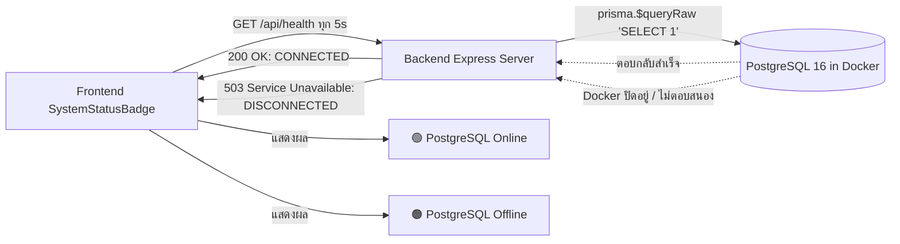

# Menu Engineering & Food Costing Platform (v2.4 Pro)

[](https://flutter.dev)
[](https://www.typescriptlang.org/)
[](https://www.postgresql.org/)
[](https://www.prisma.io/)
[](https://www.docker.com/)
[-10B981)](#คำสั่งรันชุดทดสอบ-automated-testing)

ระบบวิเคราะห์เมนูอาหารและคำนวณต้นทุนอาหารอัจฉริยะ (Menu Engineering & Food Costing Web Platform) มาพร้อมระบบจำลองสถานการณ์ต้นทุน (What-If Cost Simulation), ระบบขายหน้าร้าน (Quick POS) ตัดสต็อกวัตถุดิบอัตโนมัติตามสูตร (BOM), หน้าจอแสดงผลห้องครัว (Kitchen Display System - KDS) แจ้งเตือนกระดิ่งแบบ Real-time, ระบบควบคุมสิทธิ์ตามบทบาท (RBAC) ด้วยรหัสความปลอดภัย PIN 4 หลัก, และระบบพยากรณ์ความต้องการวัตถุดิบและป้องกันของเสียด้วย AI (AI Demand & Waste Forecasting)

---

## 📑 สารบัญ (Table of Contents)
1. [ภาพรวมฟีเจอร์เด่น (Key Features)](#ภาพรวมฟีเจอร์เด่น-key-features)
2. [สิทธิ์ผู้ใช้งานและรหัส PIN (Roles & Security PIN)](#สิทธิ์ผู้ใช้งานและรหัส-pin-roles--security-pin)
3. [ระบบตรวจจับสถานะ Docker และฐานข้อมูลสด (Live Health Monitoring)](#ระบบตรวจจับสถานะ-docker-และฐานข้อมูลสด-live-health-monitoring)
4. [โครงสร้างโปรเจกต์ (Monorepo Architecture)](#โครงสร้างโปรเจกต์-monorepo-architecture)
5. [สรุปรวมคำสั่งทั้งหมด (Consolidated Commands Cheat Sheet)](#สรุปรวมคำสั่งทั้งหมด-consolidated-commands-cheat-sheet)
   - [ขั้นตอนเริ่มต้นใช้งานแบบด่วน (Quick Start Guide)](#ขั้นตอนเริ่มต้นใช้งานแบบด่วน-quick-start-guide)
   - [คำสั่งสำหรับฐานข้อมูล (Database Commands)](#คำสั่งสำหรับฐานข้อมูล-database-commands)
   - [คำสั่งสำหรับ Backend Server](#คำสั่งสำหรับ-backend-server)
   - [คำสั่งสำหรับ Frontend (Flutter Web)](#คำสั่งสำหรับ-frontend-flutter-web)
   - [คำสั่งรันชุดทดสอบ (Automated Testing)](#คำสั่งรันชุดทดสอบ-automated-testing)
6. [การแก้ไขปัญหาที่พบบ่อย (Troubleshooting & FAQs)](#การแก้ไขปัญหาที่พบบ่อย-troubleshooting--faqs)
7. [ตาราง API Endpoints ทั้งหมด (Backend API Reference)](#ตาราง-api-endpoints-ทั้งหมด-backend-api-reference)

---

## ✨ ภาพรวมฟีเจอร์เด่น (Key Features)

- **🚪 พอร์ทัลเลือกบทบาทแบบ Zero-Scroll (Next-Gen Role Selection Portal):**
  - หน้า Landing Page (`/role-select`) สำหรับเลือกตำแหน่งก่อนเข้าใช้งานจริง
  - เลย์เอาต์แบบ **Zero-Scroll Viewport** จัดสรร 2 ฝั่ง ซ้าย-ขวา พอดีหน้าจอแม้เปิดแบ่งครึ่งจอกับ Docker Desktop (~960px) โดยไม่ต้องเลื่อนเมาส์
  - **รองรับ Physical Keyboard Numpad**: นั่งหน้าคอมพ์แล้วกดตัวเลข `0`–`9`, `Backspace`, `Esc`, และ `Enter` บนแป้นพิมพ์จริงได้ทันที
  - **ปุ่มทางลัด `⚡ เข้าด่วน` (1-Click Demo Login)** บนการ์ดทุกใบ ข้ามขั้นตอนกรอก PIN ได้ทันทีสำหรับพรีเซนต์
  - **แผงใส่รหัสสไตล์ Tactile POS Keypad**: ปุ่มกลมมนสัมผัสฮาร์ดแวร์ตู้ POS หน้าร้าน พร้อมตัวอักษรย่อย (`2 ABC`, `3 DEF`...)

- **🟢 ระบบตรวจสอบสุขภาพสดของ Docker & PostgreSQL (Live Health Monitoring):**
  - ป้ายสถานะเรียลไทม์ `SystemStatusBadge` ยิงเช็คจริงผ่านคำสั่ง `SELECT 1` บน PostgreSQL
  - แสดงสถานะตามจริง: 🟢 **PostgreSQL Online** / 🟠 **PostgreSQL Offline (เมื่อปิด Docker)** / 🔴 **เซิร์ฟเวอร์ออฟไลน์** พร้อมคลิกแตะเพื่อ Refresh สด

- **📊 Kasavana & Smith 4 Quadrants Menu Matrix:**
  - วิเคราะห์ความนิยม (Popularity / Sales Volume) และกำไรส่วนเกิน (Contribution Margin)
  - จำแนกเมนูออกเป็น 4 หมวด: **Stars** (ดาวเด่น), **Plowhorses** (ม้างาน), **Puzzles** (ปริศนา), และ **Dogs** (สุนัขจนตรอก) พร้อมข้อเสนอแนะเชิงกลยุทธ์ทางธุรกิจ

- **🍲 BOM (Bill of Materials) Recipe Costing:**
  - คำนวณต้นทุนต่อจานอย่างละเอียดระดับกรัม (g), มิลลิลิตร (ml), และจำนวนหน่วย (ฟอง/ชิ้น)
  - คำนวณอัตราสูญเสียจากการเตรียมและปรุงอาหาร (Yield Loss %) เพื่อสะท้อนต้นทุนที่แท้จริง

- **🔮 What-If Cost Impact Simulation Sandbox:**
  - แซนด์บ็อกซ์จำลองผลกระทบเมื่อราคาวัตถุดิบในตลาดผันผวน ปรับเปลี่ยนสัดส่วนสูตร หรือเปลี่ยนราคาขายเมนูแบบ Real-Time พร้อมกราฟเปรียบเทียบกำไรสุทธิทันที

- **🛒 Point of Sale (POS) & Automated Inventory Deduction:**
  - ระบบขายหน้าร้านด่วน (Quick POS) กดสั่งออเดอร์ แตะเพิ่ม-ลดจำนวน ตรวจสอบสต็อกวัตถุดิบหน้าร้าน
  - ตัดสต็อกวัตถุดิบย่อยในคลัง (BOM) อัตโนมัติทันทีที่กดยืนยันออเดอร์ พร้อมแจ้งเตือนเมื่อสต็อกไม่เพียงพอ

- **🔔 Kitchen Display System (KDS) & Real-Time WebSockets:**
  - จอคิวออเดอร์สำหรับเชฟในครัว ซิงค์ข้อมูลกับ POS แบบ Real-time ผ่าน WebSocket (`ws://localhost:5000/ws`)
  - ส่งเสียงกระดิ่งเตือนเชฟ (Bell Chime Sound) อัตโนมัติเมื่อมีออเดอร์ใหม่เข้ามาโดยไม่ต้องกดรีเฟรชหน้าจอ

- **📈 ข้อมูลจำลองยอดขายย้อนหลังเต็ม 60 วัน (60-Day Historical Big Data):**
  - จำลองออเดอร์ขายย้อนหลังต่อเนื่อง 60 วันเต็ม (275+ ออเดอร์, ยอดขายสะสมกว่า 200,000+ บาท)
  - สะท้อนพฤติกรรมการสั่งอาหารของลูกค้าจริงทั้งเมนูเดี่ยวและเมนูชุด พร้อมวัตถุดิบสดและของแห้งครบครัน

- **🤖 AI Demand & Waste Forecasting (พยากรณ์ความต้องการ & ป้องกันของเสีย):**
  - วิเคราะห์อัตราการใช้วัตถุดิบจริงรายวัน (Daily BOM Consumption Rate)
  - ประเมินวันหมดอายุตามธรรมชาติของวัตถุดิบ (Shelf-life) และคำนวณจำนวนวันที่สต็อกจะพอใช้ (Runway Days)
  - คำนวณมูลค่าที่เสี่ยงเน่าเสียทิ้ง (Potential Waste Value ฿) และแนะนำปริมาณการสั่งซื้อล่วงหน้า 7 วัน

- **⚡ 60 FPS Web Performance & Smooth Virtualized Scrolling:**
  - ปรับระบบฟิสิกส์การเลื่อนจอด้วย `BouncingScrollPhysics`
  - ทำ List Virtualization ด้วย `CustomScrollView` + `SliverList.separated` รองรับการเลื่อนดูประวัติบิล 275+ รายการได้ลื่นไหล ไม่มีสะดุด
  - ครอบ `RepaintBoundary` บนชาร์ตกราฟิกและบัตรรายการ เพื่อลดภาระการ Render ของเบราว์เซอร์

- **📄 Financial & BOM Export:**
  - ส่งออกรายงานการวิเคราะห์เมนูและต้นทุนในรูปแบบไฟล์ PDF และ CSV/Excel สำหรับนำไปใช้งานต่อ

---

## 🔒 สิทธิ์ผู้ใช้งานและรหัส PIN (Roles & Security PIN)

ระบบจำลองการทำงานของร้านอาหารจริง โดยแบ่งบทบาทออกเป็น 3 ระดับ พร้อมระบบความปลอดภัย:

| บทบาท (Role) | สีประจำตำแหน่ง | สิทธิ์การเข้าถึง | เมนูหลัก | รหัส PIN | ปุ่มลัด |
|---|:---:|---|---|:---:|:---:|
| **ผู้จัดการร้าน (Restaurant Manager)** | 🟢 เขียวมรกต (`#10B981`) | เข้าถึงครบทุกระบบ (Dashboard, Matrix, สต็อก, สูตร BOM, Simulation, POS, KDS, Forecast) | `/dashboard` | `1234` | `⚡ เข้าด่วน` |
| **หัวหน้าเชฟ & ห้องครัว (Kitchen Chef)** | 🟠 ส้มทอง (`#F59E0B`) | จอแสดงคิวอาหารห้องครัว (KDS), สัดส่วนตักปรุง (Portion Guide) และจับเวลาปรุง | `/kds` | `3333` | `⚡ เข้าด่วน` |
| **แคชเชียร์ & หน้าร้าน (Cashier / POS)** | 🔵 ฟ้าสกาย (`#38BDF8`) | ระบบขายหน้าร้านด่วน (Quick POS), รับออเดอร์ตัดสต็อก และดูประวัติบิลย้อนหลัง 60 วัน | `/pos` | `2222` | `⚡ เข้าด่วน` |

> 💡 **Master PIN Override**: สามารถใช้รหัส **`1234`** ปลดล็อกได้ทุกหน้าจอและทุกบทบาท หรือใช้ปุ่ม **`⚡ เข้าด่วน`** ที่การ์ดเพื่อข้ามขั้นตอนกรอก PIN ได้ทันทีสำหรับกรณีทดสอบระบบ

---

## 🔌 ระบบตรวจจับสถานะ Docker และฐานข้อมูลสด (Live Health Monitoring)

ระบบมาพร้อมตัวตรวจวัดความพร้อมของการเชื่อมต่อ (Real-Time Service Health Telemetry):



* **🟢 PostgreSQL Online (สีเขียว)**: ทั้งเซิร์ฟเวอร์ Backend และคอนเทนเนอร์ Docker PostgreSQL เชื่อมต่อและสื่อสารกันได้สมบูรณ์
* **🟠 PostgreSQL Offline (สีส้ม)**: เซิร์ฟเวอร์เปิดอยู่ แต่ Docker Desktop หรือคอนเทนเนอร์ PostgreSQL ถูกปิดแบบแมนนวล
* **🔴 เซิร์ฟเวอร์ออฟไลน์ (สีแดง)**: ปิด Backend Node.js Server (Port 5000)

---

## 🏗️ โครงสร้างโปรเจกต์ (Monorepo Architecture)

```text
my_first_app/
│
├── frontend/                        # [หน้าบ้าน] Flutter Web Application (Dart)
│   ├── lib/
│   │   ├── core/                    # โครงสร้างพื้นฐาน, ธีม, สิทธิ์บทบาท, ตัวเช็คสุขภาพระบบ
│   │   │   ├── constants/           # ค่าคงที่ระบบและชื่อแอปพลิเคชัน
│   │   │   ├── providers/           # user_role_provider, system_status_provider
│   │   │   ├── router/              # AppRouter รองรับ /role-select และ Guarded Routes
│   │   │   ├── theme/               # Dark Neon POS Theme Palettes
│   │   │   └── widgets/             # AppShell, SystemStatusBadge, RoleSwitcherPill
│   │   └── features/                # สถาปัตยกรรมแยกตามฟีเจอร์ (Feature-First)
│   │       ├── auth/                # RoleSelectionScreen (Zero-Scroll & Tactile Keypad)
│   │       ├── dashboard/           # Kasavana-Smith Matrix Scatter Plot & Analytics
│   │       ├── forecast/            # AI Demand & Waste Forecast (Runway Days)
│   │       ├── ingredients/         # Stock Inventory Management
│   │       ├── kds/                 # Kitchen Display System Queue & Sound Alert
│   │       ├── pos/                 # Quick POS & 60-Day Virtualized Sales History
│   │       ├── recipes/             # Recipe Builder & BOM Costing Breakdown
│   │       ├── reports/             # PDF & CSV Export Services
│   │       └── simulation/          # What-If Cost Sandbox
│   ├── test/                        # Automated Tests 54 ข้อ (Unit, Widget, RBAC ผ่าน 100%)
│   ├── web/                         # Web Index, Manifest & Hardware Acceleration Styles
│   └── pubspec.yaml                 # Flutter Dependencies
│
├── backend/                         # [หลังบ้าน] Node.js Express REST API (TypeScript)
│   ├── src/
│   │   ├── routes/                  # Ingredients, Recipes, Orders, Analytics
│   │   ├── services/                # Calculator, Orders BOM Deduction, Forecast, Simulation
│   │   ├── utils/                   # Unit Converter (g <-> kg, ml <-> L, count)
│   │   ├── prisma.ts                # PrismaClient Singleton
│   │   └── index.ts                 # Express Server (Port 5000, Live /api/health, WebSockets)
│   ├── prisma/
│   │   ├── schema.prisma            # PostgreSQL Database Schema
│   │   ├── migrations/              # Database Migration History
│   │   └── seed.ts                  # ข้อมูลตั้งต้น 60 วัน, วัตถุดิบ 12+ ชนิด, เมนู 10+ รายการ
│   ├── docker-compose.yml           # PostgreSQL 16 (Port 5433:5432)
│   └── package.json                 # Node.js Dependencies & NPM Scripts
│
└── README.md                        # คู่มือการติดตั้งและสรุปรวมคำสั่งฉบับสมบูรณ์
```

---

## 💻 สรุปรวมคำสั่งทั้งหมด (Consolidated Commands Cheat Sheet)

### ขั้นตอนเริ่มต้นใช้งานแบบด่วน (Quick Start Guide)

เปิด **Terminal 2 หน้าต่าง (หรือ 2 แท็บ)**:

#### 🟢 หน้าต่างที่ 1: รันหลังบ้าน (Backend & Database)

**วิธีที่ 1: รันแบบ Docker Compose ทั้งระบบ (สะดวกที่สุด):**
```bash
# อยู่ที่โฟลเดอร์ราก my_first_app แล้วรันคำสั่งเดียว
docker compose up -d
```
*(ระบบจะสร้างคอนเทนเนอร์ PostgreSQL และ Backend API พร้อม Seed ข้อมูลให้อัตโนมัติที่ `http://localhost:5000`)*

**วิธีที่ 2: รันแบบแยก Dev Server บนเครื่อง:**
```bash
# 1. เข้าโฟลเดอร์ backend
cd d:\CS67\my_first_app\backend

# 2. เปิดฐานข้อมูล PostgreSQL (Docker)
npm run db:up

# 3. ซิงค์ฐานข้อมูลและลงข้อมูลจำลอง 60 วัน (รันเฉพาะครั้งแรก หรือเมื่อต้องการรีเซ็ต)
npx prisma db push
npm run prisma:seed

# 4. เริ่มต้นเซิร์ฟเวอร์ Backend
npm run dev
```
*(Backend จะรันอยู่ที่: `http://localhost:5000`)*

---

#### 🔵 หน้าต่างที่ 2: รันหน้าบ้าน (Frontend - Flutter Web)
```bash
# 1. เข้าโฟลเดอร์ frontend
cd d:\CS67\my_first_app\frontend

# 2. ดาวน์โหลดแพ็กเกจ (รันครั้งแรก)
flutter pub get

# 3. เปิดเว็บแอปพลิเคชันบนเบราว์เซอร์ Chrome
flutter run -d chrome
```

---

### คำสั่งสำหรับฐานข้อมูล (Database Commands)

ทำงานที่พาธ `my_first_app/backend`:

| คำสั่ง | คำอธิบาย |
|---|---|
| `npm run db:up` | สั่งเปิดคอนเทนเนอร์ PostgreSQL 16 ผ่าน Docker ในโหมดเบื้องหลัง (`-d`) |
| `npm run db:down` | สั่งหยุดและปิดคอนเทนเนอร์ฐานข้อมูล PostgreSQL |
| `docker ps` | ตรวจสอบสถานะว่าคอนเทนเนอร์ `foodcost_postgres` กำลังทำงานอยู่หรือไม่ (พอร์ต `5433`) |
| `npx prisma db push` | ซิงค์โครงสร้างตารางจาก `schema.prisma` เข้าสู่ PostgreSQL ทันที |
| `npm run prisma:seed` | นำเข้าข้อมูลตัวอย่าง 60 วัน (275+ บิล, วัตถุดิบ, เมนูครบ 4 ควอดรันต์) |
| `npx prisma studio` | เปิดหน้าเว็บ UI กราฟิกจัดการดู/แก้ไขข้อมูลใน Database (`http://localhost:5555`) |

---

### คำสั่งสำหรับ Backend Server

ทำงานที่พาธ `my_first_app/backend`:

| คำสั่ง | คำอธิบาย |
|---|---|
| `npm run dev` | เริ่มต้น Backend API Server ด้วย `ts-node` (Port 5000) |
| `npm test` | รันชุด Automated Unit Tests ของ Backend (แปลงหน่วย, ตัดสต็อก BOM, Forecast) |
| `npm run build` | ตรวจสอบความถูกต้องของ Type ใน TypeScript ทั้งโปรเจกต์ (`tsc --noEmit`) |

---

### คำสั่งสำหรับ Frontend (Flutter Web)

ทำงานที่พาธ `my_first_app/frontend`:

| คำสั่ง | คำอธิบาย |
|---|---|
| `flutter pub get` | ดาวน์โหลดและอัปเดตไลบรารีทั้งหมดใน `pubspec.yaml` |
| `flutter run -d chrome` | รันแอปพลิเคชันบน Google Chrome พร้อมระบบ Hot Reload (`r`) / Hot Restart (`R`) |
| `flutter run -d chrome --web-port=8080` | รันบนเว็บโดยล็อกพอร์ตให้อยู่ที่ 8080 เสมอ |
| `flutter analyze` | ตรวจสอบคุณภาพโค้ด Dart และกฎเกณฑ์ Linter (0 issues) |
| `flutter test` | รันชุดทดสอบอัตโนมัติทั้งหมด 54 ชุด (ผ่าน 100%) |
| `flutter build web --no-tree-shake-icons` | บิลด์ไฟล์ Production สำหรับนำไป Serve บน Backend |

---

### คำสั่งรันชุดทดสอบ (Automated Testing)

#### 1. ทดสอบส่วนหลังบ้าน (Backend - 12 ข้อ)
```bash
cd backend
npm test
```
*ครอบคลุม: การแปลงหน่วยกรัม/กิโลกรัม/ลิตร, การคำนวณ Yield %, โครงสร้าง Error เมื่อสต็อกไม่พอ, การตัดสต็อกวัตถุดิบ BOM, และการประเมิน Shelf-life & Demand & Waste Forecast (ผ่าน 100%)*

#### 2. ทดสอบส่วนหน้าบ้าน (Frontend - 54 ข้อ)
```bash
cd frontend
flutter test
```
*ครอบคลุม: Smoke Test, Unit Test, Widget Test, การจำลองสถานการณ์ What-If, การ Export รายงาน, สิทธิ์บทบาทผู้ใช้งาน (RBAC), แป้นพิมพ์ PIN, หน้าเลือกบทบาท, เมนูบนหน้าจอมือถือ, และหน้าจอ AI Demand & Waste Forecast (ผ่าน 100%)*

---

## ❓ การแก้ไขปัญหาที่พบบ่อย (Troubleshooting & FAQs)

### 1. ปิด Docker แบบแมนนวลแล้ว ทำไมหน้าเว็บก่อนหน้านี้ยังขึ้นว่า "Online"?
- **สาเหตุ**: ก่อนหน้านี้ข้อความบนหน้าจอเป็น Text คงที่ และ Endpoint `/api/health` ไม่ได้ยิงตรวจสอบกับฐานข้อมูลจริง
- **การแก้ไขใน v2.4 Pro**: อัปเกรดเป็น `SystemStatusBadge` และปรับปรุง Endpoint หลังบ้านให้รันคำสั่ง `prisma.$queryRaw\`SELECT 1\`` ทดสอบสดทุกครั้ง หาก Docker ดับ ป้ายจะเปลี่ยนเป็น **สีส้ม `● PostgreSQL Offline`** อัตโนมัติทันที

### 2. สามารถกดตัวเลขจากแป้นพิมพ์คีย์บอร์ดจริงได้หรือไม่?
- **ได้ทันที**: หน้าพอร์ทัลเลือกบทบาทรองรับ **Physical Keyboard Listener** สามารถกดพิมพ์ตัวเลข `0`–`9` (ทั้งแป้นพิมพ์หลักและแป้น Numpad), กด `Backspace` เพื่อลบ, กด `Esc` เพื่อล้างข้อมูล และกด `Enter` เพื่อยืนยันเข้าสู่ระบบได้ทันที

### 3. เปิดหน้าต่างครึ่งจอกับ Docker Desktop แล้วแป้นพิมพ์ PIN หลุดขอบจอหรือไม่?
- **ไม่หลุดจอแล้ว (Zero-Scroll Layout)**: ปรับปรุง Breakpoint เป็น `820px` ทำให้เมื่อเปิดจอแบบ Split Screen (~960px) ระบบจะจัดหน้าเป็น **2 คอลัมน์ (ซ้ายเลือกบทบาท, ขวาแป้น PIN)** พอดีสายตา 100% โดยไม่ต้องเลื่อนเมาส์ลงล่าง

### 4. รัน `npm run dev` แล้วแจ้ง `Missing script: "dev"`
- **วิธีแก้**: ในเวอร์ชันปัจจุบันได้เพิ่ม `"dev": "ts-node src/index.ts"` ลงใน `backend/package.json` เรียบร้อยแล้ว สามารถพิมพ์ `npm run dev` หรือ `npm run server:dev` ได้ทั้งสองแบบ

### 5. ตารางในฐานข้อมูลไม่ตรง หรือฟ้องว่า Table does not exist
- **วิธีแก้**: รันคำสั่งซิงค์ Schema ใหม่ด้วย:
  ```bash
  cd backend
  npx prisma db push
  npm run prisma:seed
  ```

---

## 🌐 ตาราง API Endpoints ทั้งหมด (Backend API Reference)

Base URL: `http://localhost:5000/api`

| หมวดหมู่ | Method | Endpoint | คำอธิบายการทำงาน |
|---|---|---|---|
| **Health** | `GET` | `/health` | ตรวจสอบสถานะการเชื่อมต่อ Server และ **PostgreSQL Connection Test สด** |
| **Ingredients** | `GET` | `/ingredients` | ดึงรายการวัตถุดิบทั้งหมด ปริมาณคงเหลือ และราคาต่อหน่วย |
| | `POST` | `/ingredients` | เพิ่มวัตถุดิบใหม่เข้าคลัง (คำนวณ Base Unit Cost อัตโนมัติ) |
| | `PUT` | `/ingredients/:id` | แก้ไขข้อมูลวัตถุดิบหรือปรับปรุงราคาซื้อ |
| | `DELETE` | `/ingredients/:id` | ลบวัตถุดิบที่ไม่ใช้งานออกจากระบบ |
| **Recipes** | `GET` | `/recipes` | ดึงรายการสูตรอาหารทั้งหมด พร้อมส่วนผสม BOM |
| | `POST` | `/recipes` | สร้างสูตรอาหารใหม่พร้อมส่วนผสมและสัดส่วน Yield |
| | `GET` | `/recipes/:id/cost-breakdown` | แจกแจงต้นทุนวัตถุดิบแต่ละชนิดต่อจาน และ % Food Cost |
| **Orders** | `GET` | `/orders` | ดึงประวัติรายการสั่งซื้อทั้งหมด (รองรับข้อมูลย้อนหลัง 60 วัน) |
| | `GET` | `/orders/:id` | ดูรายละเอียดรายการสั่งซื้อรายออเดอร์ |
| | `POST` | `/orders` | บันทึกออเดอร์ใหม่จาก POS พร้อมตัดสต็อกวัตถุดิบ (BOM) ในคลังทันที |
| **Analytics** | `GET` | `/analytics/menu-matrix` | คำนวณ Kasavana & Smith Matrix จัดหมวด 4 Quadrants |
| | `GET` | `/analytics/waste-forecast` | **พยากรณ์ความต้องการวัตถุดิบ & ของเสีย**: Shelf-life, Runway Days, มูลค่าเสี่ยงเน่าเสีย (฿) และข้อเสนอแนะสั่งซื้อ 7 วัน |
| **Simulation** | `POST` | `/analytics/simulate-cost` | ประมวลผล What-If Sandbox จำลองการเปลี่ยนแปลงต้นทุน |

---

*© 2026 MenuEng Pro — Intelligent Restaurant Engineering Platform | CS67 Food Cost Analyzer Project*
